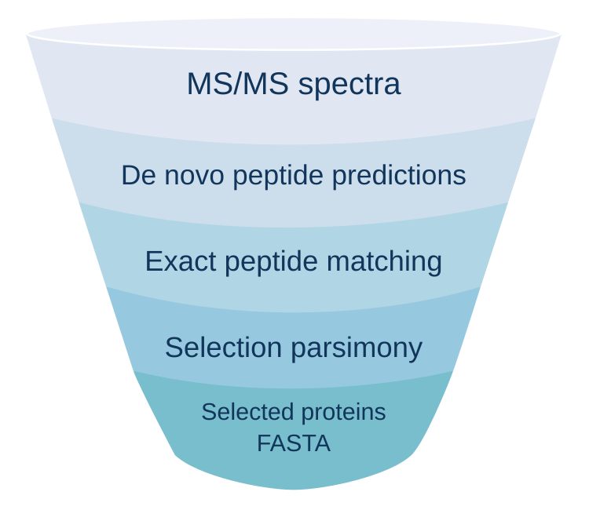

# FastaLake

[**Read the paper — bioRxiv**](https://www.biorxiv.org/content/10.64898/2026.10.08.757395v1) · [DOI: 10.64898/2026.10.08.757395](https://doi.org/10.64898/2026.10.08.757395)

[](https://github.com/MannLabs/fasta-lake/releases/tag/v1.1.0rc2)
[](https://github.com/MannLabs/fasta-lake/actions/workflows/ci.yml)
[](docs/get-started/install.md#source-installation)
[](LICENSE)

**[Install](#installation) · [Quickstart](#quickstart) · [Documentation](https://mannlabs.github.io/fasta-lake/) · [Examples](#examples) · [Paper code](https://github.com/treitpeter/fastalake-paper)**

FastaLake uses de novo peptide predictions to select compact protein databases
for metaproteomics. It retrieves complete proteins from a large sequence
reservoir, selects a database for each mass spectrometry acquisition, and runs
[Sage](https://github.com/lazear/sage) to identify peptides. Study-wide protein
grouping and quantification turn those results into a matrix ready for analysis.

<p align="center">
  
</p>

## Features

- Select complete proteins from public sequence catalogues using exact peptide lookup.
- Search and quantify a study from one acquisition manifest.
- Add matched metagenomic or metatranscriptomic sequences when available.
- Process large reservoirs in chunks when memory is limited.
- Inspect peptide evidence, protein-group quantities and QC plots.

| Input | Supported route |
|---|---|
| Spectra | One mzML or mzML.gz file per DDA acquisition |
| De novo predictions | AlphaNovo CSV or generic `sequence,score` CSV, optionally gzipped |
| Protein sequences | Prepared protein FASTA reservoir |
| Matched molecular data | Optional specimen-matched DNA/RNA sequences and abundance tables |

RAW conversion and de novo inference happen before FastaLake. See
[accepted inputs](docs/how-to/de-novo-inputs.md) and
[preparing a study](docs/how-to/acquisition-manifest.md).

## Installation

| Route | Best for |
|---|---|
| **[Docker](docs/get-started/install.md#published-image)** | A first run with the tools and examples already bundled |
| **[Source](docs/get-started/install.md#source-installation)** | Python development or a Linux cluster |
| **[Apptainer / Slurm](docs/how-to/cluster.md)** | Running a study on a research cluster |

With Docker installed:

```bash
docker pull --platform linux/amd64 ghcr.io/mannlabs/fasta-lake:v1.1.0rc2
```

The image includes Python, compiled Rust tools, Sage, directLFQ, AlphaPeptTools
and example inputs. It targets Linux x86_64; Apple Silicon uses Docker's x86_64
emulation. The published release is `v1.1.0rc2`; development changes on `main`
are available through the source or local Docker build instructions.

## Quickstart

Run two small, real CAMPI acquisition windows and write the results locally:

```bash
mkdir -p fastalake-results
docker run --rm --platform linux/amd64 --network none \
  --memory 4g --memory-swap 4g --cpus 2 \
  --user "$(id -u):$(id -g)" -v "$PWD/fastalake-results:/work" \
  ghcr.io/mannlabs/fasta-lake:v1.1.0rc2 \
  fastalake-example campi --out /work/campi_01 --threads 2
```

Open these files in `fastalake-results/campi_01/`:

| File | Result |
|---|---|
| `study/qc/QC_overview.png` | Quantities, group counts and completeness across acquisitions |
| `study/study_group_matrix.tsv` | Protein-group quantities |
| `study/peptide_evidence.tsv.gz` | Peptides supporting each group |
| `workflow/samples/S01/inference/S01_razor.fasta` | The selected protein database |

The example checks its outputs and saves `VALIDATION.json`. Use a new output
folder for each run. Continue with [your first study](docs/get-started/first-study.md)
or [reading the results](docs/how-to/read-outputs.md).

## Examples

| Example | What you learn |
|---|---|
| [CAMPI](examples/campi/README.md) | Selection, searching, grouping and quantification |
| [Chunked lookup](examples/chunked/README.md) | Processing a reservoir within a memory budget |
| [Matched DNA and RNA](examples/multiomics/README.md) | Adding molecular evidence to the selected database |
| [Community analysis](examples/community/README.md) | Exploring taxonomy and peptide–protein links |

[Browse the tutorials](docs/tutorials/index.md), follow the
[visual walkthrough](docs/concepts/walkthrough.md), or use an
[assistant task file](docs/how-to/assistants.md) to work through a study.

## Citation and credits

Treit et al. (2026). *FastaLake selects compact metaproteomic databases from large sequence reservoirs by de novo peptide lookup*. [bioRxiv](https://www.biorxiv.org/content/10.64898/2026.10.08.757395v1).
Please also cite the software version used; see [CITATION.cff](CITATION.cff).
The manuscript analyses and source tables are maintained in
[fastalake-paper](https://github.com/treitpeter/fastalake-paper).

FastaLake uses [Sage](https://github.com/lazear/sage),
[directLFQ](https://github.com/MannLabs/directlfq) and
[AlphaPeptTools](https://github.com/MannLabs/alphapepttools). Please cite these
projects when using their results.

## Contributing

Report a reproducible problem in [Issues](https://github.com/MannLabs/fasta-lake/issues).
For setup, tests and pull requests, see [Contributing](.github/CONTRIBUTING.md).
Code is under the [MIT licence](LICENSE); bundled data and dependencies retain
their own terms.
